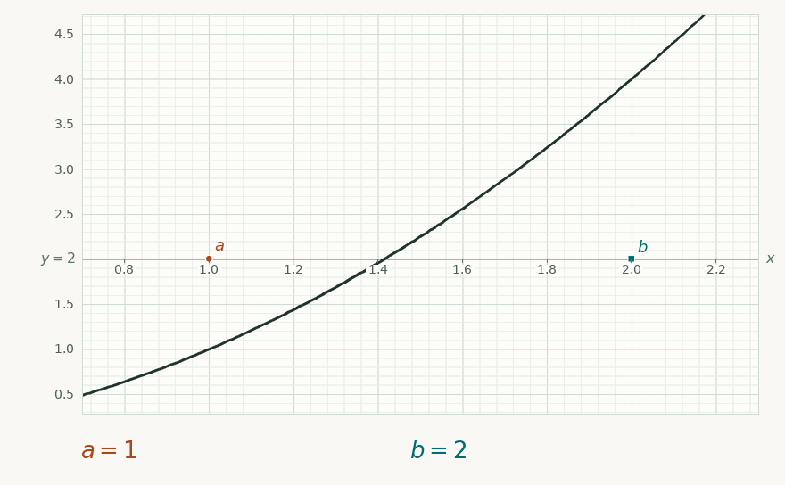

# Chapter 1. Computable numbers and functions

## A computation for the square root of two

Start with $[a,b]=[1,2]$. On the graph of $y=x^2$, draw a secant through the two endpoints and a tangent at the right endpoint. Where they meet $y=2$, their horizontal coordinates give the next bounds.

The secant gives the lower bound and the tangent gives the upper bound.

$$
a'=\frac{2+ab}{a+b},\qquad b'=\frac{b+2/b}{2}.
$$

The first three intervals are $[1,2]$, $[4/3,3/2]$, and $[24/17,17/12]$. Their squared endpoints enclose $2$. Each interval lies inside the previous one, and the width at least halves at every step. This sequence of rational pairs represents $\sqrt{2}$.

## Real numbers

A real name assigns two rational endpoints to each stage.

$$
n\longmapsto [a_n,b_n],\qquad a_n,b_n\in\mathbb Q .
$$

The intervals are nonempty and nested, and $b_n-a_n\to0$. The stage $n$ counts refinements. We impose no prescribed rate. In Lean the data are a `RealCompute` and the three conditions are `RealCompute.Valid`. When the stage map is an algorithm we informally call the name computable.

Two valid names are equivalent if their intervals overlap at every stage. A real number is an equivalence class of valid names. A rational $r$ has the constant name $[r,r]$. A second algorithm for $\sqrt{2}$ is bisection on $[1,2]$. Its intervals and the secant–tangent intervals cannot be disjoint because both enclose a nonnegative solution of the same squared-endpoint inequalities.

## Arithmetic and order

Add the lower endpoints and add the upper endpoints. To negate an interval, take $[-b,-a]$. For multiplication take the smallest and largest of the four endpoint products. Where a nonzero operand has eventually settled on one sign, we can drop an initial segment and use the corresponding endpoint formula. A reciprocal requires a bracket separated from zero. On either sign its interval is $[1/b,1/a]$.

A strict inequality is witnessed at a finite stage where the intervals are disjoint and ordered. These operations and the order respect equivalence. The quotient is `ComputableAnalysis.Real`. Its comparison with Mathlib's reals and with rational Dedekind cuts lives in the separate comparison package.

## Complex numbers

A complex name gives a rational box at every stage. Equivalently it gives two real names, one for each coordinate of $z=x+iy$. Lean calls these names `ComplexCompute` and their quotient `ComputableAnalysis.Complex`.

## Functions and inverses

Numbers lead to functions. In the opening example the target $2$ can be replaced by a rational $q\ge0$. The construction then gives a rule on rational inputs with values that are real names. Complex rules begin on rational complex inputs or on a stated rational chart.

If a rational rule $f$ is increasing on an interval and the brackets $[a_n,b_n]$ eventually lie there, use lower bounds for $f(a_n)$ and upper bounds for $f(b_n)$. For a decreasing rule, swap the roles of the endpoints. Choose the evaluation stages so that these output bounds shrink, and prove that equivalent input names give equivalent outputs. This is the interval construction of continuity. On monotonicity intervals, polynomials and rational functions provide examples, with the denominator kept away from zero.

For a strictly increasing continuous rule, a target strictly between two values can be enclosed in the image of increasingly short rational brackets. Search for endpoints with strict inequalities on either side of the target. The resulting name computes the inverse without deciding whether two real names are equal.

The [value-predicate note](01c-real-classification-api.md) covers rationality and algebraicity. The [continued-fractions chapter](06b-continued-fractions.md) gives another way to read an interval computation.
