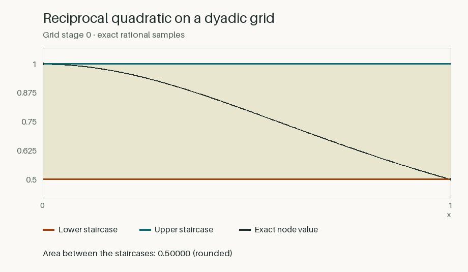
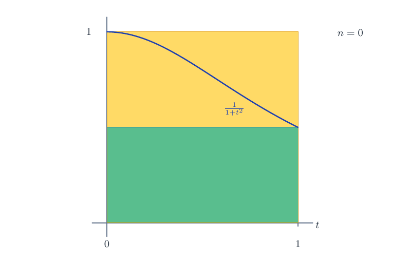
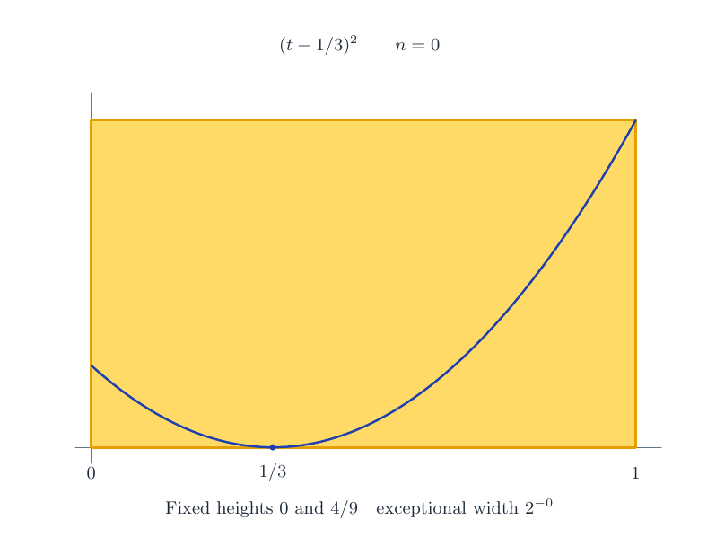
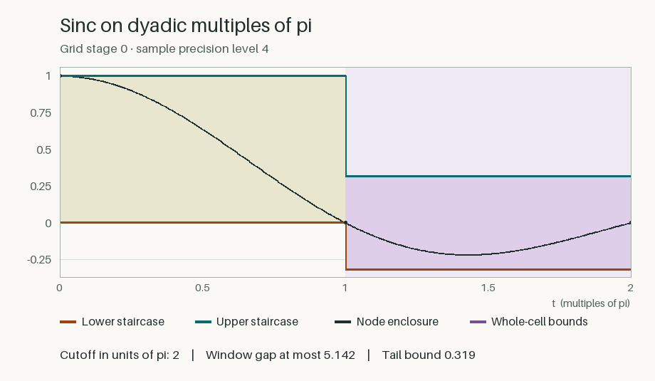
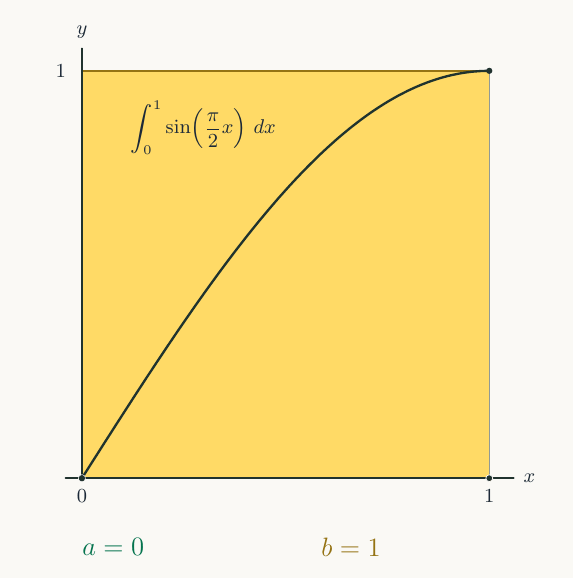

# Chapter 3. Integration, derivatives, and the fundamental theorem

## Start at the integers

How much does the decreasing rate $1/t$ accumulate between $1$ and $3$?
At level $0$, use the cells $[1,2]$ and $[2,3]$. The right endpoint values
give the lower sum, and the left endpoint values give the upper sum. The
result is the enclosure $[5/6,3/2]$. At level $1$, insert $3/2$ and $5/2$
and repeat. The two sums tighten without needing a formula for the logarithm.

This is our default definite-integral construction. At stage $n$, take the
endpoints of the ordered rational interval $[a,b]$ together with every
interior grid point $k/2^n$ for $k\in\mathbb Z$. Stage $0$ uses the integers,
stage $1$ inserts the half-integers, and stage $2$ inserts the odd quarter-integers.
The grid stays fixed when the endpoints change: for example, on
$[1/3,8/3]$ the first grid points are $1/3,1,2,8/3$. Only the end cells
are clipped. When $a=b$, the integral is zero.

For every cell $[t_j,t_{j+1}]$, certify lower and upper heights $m_{n,j}$
and $M_{n,j}$ that enclose the values throughout the cell. Set

$$
L_n=\sum_j m_{n,j}(t_{j+1}-t_j),\qquad
U_n=\sum_j M_{n,j}(t_{j+1}-t_j).
$$

The evidence belongs to the function; the grid does not. If the total
area gap $U_n-L_n$ tends to zero, the intervals define a valid
`RealCompute`. A finite common refinement proves $L_i\le U_j$ for every pair
of levels: each refined cell has a rational sample whose value lies between
both sets of bounds. The enclosing interval at stage $n$ is the intersection
$[\max_{i\le n}L_i,\min_{i\le n}U_i]$. These intervals are nonempty and
nested. Their widths tend to zero because each lies within $[L_n,U_n]$. The same
comparison proves agreement for different certified heights and precision
schedules. A faster computation can represent the same integral once its
agreement is proved.

## Exact samples for arctangent

For \(f(x)=1/(1+x^2)\) on \([0,1]\), the left and right endpoint values
are exact rationals. On each cell, the left value supplies the upper
height and the right value supplies the lower height. At an interior
grid point, the upper staircase to its right and the lower staircase to
its left meet at the same sample. The shaded area between the
staircases is the uncertainty in the integral.

## Constant and simple functions, interval addition, and bounds

The basic integral contract starts with constants and finite piecewise
constant functions. Here a **simple function** means a step function on a
finite interval partition. It does not refer to an unspecified measurable-set
theory. Initially take rational partition points; its constant values can be
arbitrary valid represented reals. Fix the endpoint convention when defining
the sampler, and prove that isolated endpoint choices do not affect the
integral rather than assuming that fact silently.

For a constant value, the normalization is

$$
\int_a^b c\,dt\simeq(b-a)c.
$$

Finite interval addition gives the value for a supplied simple function:

$$
\int_a^b s(t)\,dt\simeq
\sum_{j=0}^{N-1}(t_{j+1}-t_j)c_j,
\qquad a=t_0<\cdots<t_N=b.
$$

Prove that refining its presentation does not change this value. For any
supplied function and justified integral witnesses on adjacent intervals,
the interval-addition law is

$$
\int_a^c f(t)\,dt\simeq
\int_a^b f(t)\,dt+\int_b^c f(t)\,dt,
\qquad a\le b\le c.
$$

This is a conditional comparison of supplied witnesses, not an assumption
that every interval already has a chosen integral.

Finally, simple functions supply the required order tests. If they bound the
supplied integrand on the entire interval, every justified integral value
must obey

$$
s_-(t)\le f(t)\le s_+(t)\quad\Longrightarrow\quad
\int_a^b s_-(t)\,dt\le\int_a^b f(t)\,dt
\le\int_a^b s_+(t)\,dt.
$$

These are the proposed common laws. Constants already have a construction
theorem in the current interface; a general simple-function constructor,
refinement comparison, and adjacent-interval law must be checked at their
actual implementation scope before being marked proved. No new integral
record is introduced here that assumes the desired identification or
uniqueness conclusion.

The laws do not assert existence or determine a unique integral for every
function. If all available simple bounds leave a positive gap, they can
permit several values. For functions with arbitrarily tight simple bounds,
the bounds do identify at most one value; that is a proved sufficient route.
Other particular constructions may be justified by additional mathematical
evidence and comparison laws. Do not turn tight simple approximation into
a compulsory hypothesis for every method.

## The monotone quadrature construction

On a cell where the function is nondecreasing, use the lower bound for
the left endpoint value and the upper bound for the right endpoint value.
Where it is nonincreasing, swap the roles. Suppose the whole interval
is monotone and $V$ bounds its total endpoint variation. If each
represented sample has width at most $\tau_n$, then

$$
U_n-L_n\le 2^{-n}V+2(b-a)\tau_n.
$$

Indeed, each cell length is at most $2^{-n}$, and the sum of the absolute
endpoint differences telescopes. Each of the two endpoint enclosures
can add at most $\tau_n$ to the height gap, so the total evaluation
charge is at most $2(b-a)\tau_n$.

The spatial level is exactly $n$. Evaluation has its own precision: there
are only finitely many endpoint values at each level, so rational width
search can refine each until the chosen tolerance is met. Exact rational
values need no search. Merely giving every evaluator the index $n$ does
not guarantee that the total error shrinks.

## The arctangent comparison

For the rational kernel of Chapter 2, endpoint evaluation is exact. Only
spatial subdivision contributes uncertainty, and decreasing-kernel rectangle
bounds can be compared cell by cell with the geometric sector bounds.
The intended identity is

$$
\int_0^x\frac{dt}{1+t^2}\simeq A(x).
$$

On the checked unit branch, the raw quadrature value is valid and equivalent
to the geometric arctangent by the existing `ArctanGeometry` results. These
are substantial construction and comparison results. To advertise the
display as a theorem of a semantic integral interface, also certify that
the actual quadrature satisfies that interface for the entire segment.
The word “integral” in a constructor name does not discharge that obligation.
Extensions beyond the checked branch need their own construction or transport
proofs; negative endpoints use justified orientation.

`ArctanPositiveFTC.dyadicIntegral_equiv_geometric` now identifies the
independently evaluated fixed-grid integral from $0$ to any rational
$b\in[0,1]$ with the geometric arctangent at $b$.

## The current semantic interface and its boundary

`Integral.HasIntegral` presently uses arbitrarily tight finite rectangle
tests. It proves uniqueness and representation invariance at that scope.
`Integral.HasIntegral.ftc` applies to an independently supplied witness and
`Integral.CellDerivativeBounds`, which gives local inequalities about the
actual endpoint function. Finite telescoping yields

$$
\int_a^b f(t)\,dt\simeq P(b)-P(a).
$$

`FTCStepQuadrature.dyadic_ftc` applies this law directly to a
`BoundsQuadrature.DyadicData` certificate. Its separate derivative
hypothesis gives the increment bounds on each segment, so the endpoint
formula follows regardless of how the integrand's cell ranges were found.
The
rectangle criterion is a useful sufficient route, not the mandatory meaning
for every new function-specific integral construction. Separating the
intended method-independent laws from this route remains open design and
proof work. Broader uniqueness needs justified comparisons or common laws,
not an assumed uniqueness field.

## Keep the heights, shrink the turning cells

Consider $f(t)=(t-1/3)^2$ on $[0,1]$. Every dyadic cell except the one
containing $1/3$ is monotone. On that one cell, reuse the same heights
$0$ and $4/9$ at every level. Its contribution to the area gap is at most
$(4/9)2^{-n}$. You do not need to compute $f(1/3)$ or insert $1/3$ into
the grid. The uncertainty disappears because the cell gets narrower.

More generally, with at most $r$ turning points and fixed height ranges
of width at most $H$ on their cells, the unresolved contribution is at
most $rH2^{-n}$: a turn on a grid boundary needs no exceptional cell if
both adjacent cells are monotone. If the turns are given by shrinking
rational brackets rather than by exact locations, mark every cell meeting
the brackets as exceptional. A bracket of width $w$ meets cells whose
combined length is at most $w+2\cdot2^{-n}$. The height bounds must cover
those whole cells. Fixed heights work when the *total exceptional length*
goes to zero; reusing them on a fixed neighborhood of positive length does
not give that guarantee.

For normalized geometric sine and cosine, periodicity and the proved
monotonicity intervals locate the turns exactly. Sine turns at the
half-integers and cosine at the integers. The cosine turns are on the
level-$0$ grid, and the sine turns are on the grid from level $1$ onward.
Use the known bounds $[-1,1]$ on any unresolved cell, and the endpoint
bounds wherever monotonicity is known.

## Sine divided by its argument

Use the normalized grid coordinate \(t=x/\pi\). For a positive rational
node \(t\), the sampler gives \(\sin(\pi t)\) and the argument \(\pi t\)
is a represented real. Their quotient
\[
F(t)=\frac{\sin(\pi t)}{\pi t}
\]
is a `RealCompute`. Use \(F(0)=1\), the removable limit.
The bars at sampled nodes are rational output enclosures. The two
staircases at a node with a nonzero evaluation gap can get arbitrarily
close while still staying apart. At a known zero the two can meet exactly.

On cells with a certified direction of monotonicity, take bounds from
the two ends. Purple marks cells where the illustration instead uses a
whole-cell estimate. As the grid refines, the evaluation intervals also
shrink. A cell of width \(\Delta t\) contributes physical width
\(\pi\Delta t\), so multiply the area gap in the plotted coordinate
by \(\pi\).

This leaves a second error from the omitted tail. With physical cutoff
\(R\), integration by parts gives
\[
\left|\int_R^S\frac{\sin x}{x}\,dx\right|\le \frac{2}{R},
\qquad S\ge R>0.
\]
The bound uses cancellation from oscillation. The animation shows the
window gap and tail allowance separately as its cutoff advances. The
[sine-integral chapter](06a-dirichlet-integral.md) gives the improper
construction and its evaluation.

### Two grids from the circle

This animation puts the dyadic grid in the normalized angle \(t=x/\pi\).
Inserting the angular midpoint lets us apply the half-angle formulas
again, with the signs supplied by the quadrant. The grid is uniform in
the physical angle \(x\).

The rational circle chart offers a second grid. Put \(v=\tan(x/2)\)
and take dyadic values of \(v\). In this coordinate the circle values
are rational at every node:

$$
\sin x=\frac{2v}{1+v^2},\qquad \cos x=\frac{1-v^2}{1+v^2}.
$$

The node's physical angle is \(x=2\arctan v\) on the chart
\(-\pi<x<\pi\). The resulting angles are nonuniform. A cell has physical
width \(2(\arctan v_{j+1}-\arctan v_j)\), and dividing its rational sine
value by the represented angle still calls for represented arithmetic.
These are two ways of choosing nodes for the same geometric function.

## Integrating a continuous sampler without locating its turns

A continuous function can have infinitely many turns. For a generic
sampler, a sufficient certificate is a uniform bound $\omega_n$ on the
variation between any two points within distance $2^{-n}$ on the integration
interval, with $\omega_n\to0$. Take one sample per cell and widen its
enclosure by $\omega_n$ in each direction. If the sample width is at most
$\tau_n$, the total area gap is at most

$$
(b-a)(\tau_n+2\omega_n).
$$

For a supplied Lipschitz constant $C$, take $\omega_n=C2^{-n}$. A supplied
uniform continuity modulus also gives a construction: for each requested
oscillation tolerance it tells us a level beyond which the mesh is small
enough. This is a constructive guarantee for the continuous functions
for which we can supply that control. Pointwise continuity at each
rational input alone does not supply a whole-cell bound or a uniform
precision schedule.

In the Fourier transform the function to bound is the test multiplied
by the sine or cosine of the phase. Compact smooth tests in this project
supply a Lipschitz certificate; the product estimate derives the
whole-cell bounds without solving for any turning points. The same rule
can be used one coordinate at a time on a rational box. For an improper
integral, apply the finite construction to each truncation and prove a
separate bound on the omitted contribution. Choose cutoffs and finite-grid
levels so that both the tail error and the finite area gap tend to zero.

## Worked example: the squares of sine and cosine

Start with the geometric functions $S(t)=\sin(\pi t)$ and
$C(t)=\cos(\pi t)$. Their derivative laws give

$$
(S^2+C^2)'=0,\qquad (SC)'=\pi(C^2-S^2).
$$

At $t=0$ the first sum equals $1$. FTC therefore gives $S^2+C^2=1$,
and the second identity separates the two integrals. For $0\le a\le b\le1$,

$$
\begin{aligned}
\int_a^b S(t)^2\,dt &\simeq \frac{b-a}{2}
  -\frac{S(b)C(b)-S(a)C(a)}{2\pi},\\
\int_a^b C(t)^2\,dt &\simeq \frac{b-a}{2}
  +\frac{S(b)C(b)-S(a)C(a)}{2\pi}.
\end{aligned}
$$

Both correction terms vanish on $[0,1/2]$, so both integrals equal $1/4$.
`GeometricIntegralData.trigSquareIntegral_equiv_endpoint` compares the
fixed-grid computations with these endpoint formulas.

## Derivatives as continuous extension of the quotient

Once the necessary function evaluations are justified, fix an input point
and form the punctured difference quotient

$$
Q_{F,x}(h)=\frac{F(x+h)-F(x)}{h},\qquad h\ne0.
$$

The derivative is the value at zero of a continuous extension of this
quotient, when such an extension is constructed:

$$
DF(x)\simeq\widetilde Q_{F,x}(0).
$$

The extension must cover sufficiently nearby punctured quotient values.
Filling in an arbitrary valid value at zero is insufficient: it must agree with all
the punctured quotient observations and make the output brackets shrink
there. At a boundary retain the intended one-sided domain. For represented
base points, justify the derived function evaluations used in the quotient;
do not silently replace the rational-input primary function by an assumed
extension.

Each function supplies the quotient enclosures or secant bounds appropriate
to it. For arctangent, reuse the fixed dyadic geometry and local kernel
bounds. No universal differentiation procedure is required. The existing
`BracketDerivative.HasDerivativeAt` instead states a common limit of all
admissible rational endpoint secants. Its checked uniqueness and congruence
laws remain available. Agreement between that interface and the quotient
extension formulation needs an explicit bridge under the relevant continuity
and domain evidence; it is not asserted merely because both use the word
derivative.

**Another construction route: Cauchy's formula.** For a complex function with
a justified Cauchy representation, a positively oriented simple contour
$\gamma$ enclosing a neighborhood of $z$ gives a candidate computation

$$
D_\gamma f(z)=\frac{1}{2\pi i}
  \int_\gamma\frac{f(\zeta)}{(\zeta-z)^2}\,d\zeta.
$$

Certify that the contour and its interior lie in the function's domain,
prove separation from the evaluation neighborhood, and justify the contour
integral with its error bounds. Subtracting the Cauchy representations at
$z+h$ and $z$ yields a difference quotient whose kernel converges uniformly
to this squared kernel. That argument identifies the computation with the
derivative and permits comparison of different valid contours. It does not
change the derivative specification. If Cauchy's theorem was proved from
holomorphicity using a derivative witness, this is a new computation of that
derivative; it does not supply a prior definition of holomorphicity. The
geometric real sine/cosine FTC development remains independent of this
complex route. See `skills/holomorphic-functions/SKILL.md`.

## Constructed convex and concave derivatives: a checked FTC

The first calculus goal after the integral specification is the recovery law

$$
\int_a^b DF(t)\,dt\simeq F(b)-F(a).
$$

For a convex function, left secants bound the derivative from below and right
secants bound it from above. Concavity reverses these bounds. Convexity alone
does not make their gap vanish: the function

$$
F(x)=|x|
$$

has a corner at zero. A function-specific construction must prove that its
actual outer-secant intervals are ordered, nested, and shrink. No generic
ordinary derivative is asserted at corners.

`ConvexFTC.OuterSecants` packages the executable rational sampling schedule
and these validity proofs. The secants surround the full input interval, not
only a chosen rational approximation. `OuterSecants.hasDerivative` identifies
their value with `RealSecantDerivative.HasDerivativeAt`, which controls all
sufficiently nearby rational secants. The input may be any valid represented
real. `OuterSecants.equiv` proves agreement for different valid schedules and
equivalent input names. The quotient-extension bridge discussed above remains
a separate target.

From ordered secants the module derives supporting-slope inequalities:

$$
DF(u)\le\frac{F(v)-F(u)}{v-u}\le DF(v),\qquad u<v
$$

in the convex case, with the endpoint derivatives reversed in the concave
case. Thus the constructed derivative is nondecreasing or nonincreasing.
Multiplying these inequalities by each cell length and telescoping gives
rectangle bounds for the endpoint difference. This argument needs no attained
mean-value witness.

The signed monotone quadrature in `ConvexFTC` works with represented values
of either sign. For a uniform partition into a positive number of cells, the
finite gap estimate separates spatial and evaluator error:

$$
U-L\le\frac{b-a}{N}B+(b-a)\tau.
$$

Here the nonnegative rational bound is computed from endpoint boxes, and
each sampled evaluator width is at most the supplied positive tolerance.
`boundsAtTolerance_gap` proves that the internal cell count and width searches
meet any requested positive rational error. This checked evaluator still
chooses its uniform cell count from the error budget; it has not been
migrated to the integer-first grid described above.

`ConvexFTC.integral` evaluates these rectangles independently and intersects
finite prefixes to repair nesting. The previously derived endpoint bounds
justify nonempty intersections; an integral identity is not an input field.
`integral_hasIntegral` certifies this computation in the current rectangle
relation, and `integral_ftc` proves the displayed exact recovery law.
`integral_equiv` compares the integral computations from different supplied
valid secant schedules.
The proper integral bounds are rational. The older outer-secant route needs
its supplied neighborhood to remain inside the proved curvature domain.
`ConvexFTCClosed` now supplies a second route using actual relative derivatives
on the closed interval itself. It derives supporting slopes from all-pair
secant limits and the weighted identity for adjacent secants; at an included
endpoint, one-sided evidence suffices. No curvature outside the interval is
requested. `closedIntegral_hasIntegral` and `closedIntegral_ftc` certify an
independently executed signed quadrature. `closed_ftc` applies to any supplied
actual integral, and `oriented_ftc` also covers reversed or coincident bounds.

The companion `ConvexFTCExamples` instantiates the full construction for
the square and its concave negative, including an interval crossing the
derivative's zero. It also proves the supporting-slope integral law for an
affine function with any valid represented coefficient, including irrational
coefficients. These are checked reference cases, not extra core imports.

## Differentiating accumulated monotone integrals

`MonotoneFTC.accumulated` independently computes the primary rational sampler

$$
P(q)=\int_a^q f(t)\,dt,\qquad q\in\mathbb Q\cap[a,b].
$$

When the supplied integrand is increasing, this accumulation is convex; when
it is decreasing, the accumulation is concave. The `curved` theorem derives
this from integral increments and monotone endpoint bounds, without a sign
restriction on the integrand.

Under the chapter-one endpoint continuity criterion, the covered derivative
of this rational sampler at any valid represented source point is the
integrand's justified extension value:

$$
DP(x)\simeq f(x).
$$

`MonotoneFTC.hasDerivativeAt` applies to any independently justified accumulated
integral samples. Its proof derives the integral role of increments by interval
additivity, then squeezes every nearby secant between actual integrand endpoint
boxes. Validity of those boxes makes the gap shrink. `accumulated_hasDerivativeAt`
instantiates the law with the executed quadrature. No general product, chain,
or inverse derivative law is needed.

`closed_hasDerivativeAt` and `exists_closed_derivative` cover the entire closed
represented source interval, including relative endpoint derivatives. Clipping
is internal, so a valid input name may straddle an included boundary.
`closed_value_congr` proves agreement for equivalent names and different valid
endpoint computations. `EndpointContinuity.HasValueAt` records only an actual
valid integrand endpoint computation and its value; it assumes no derivative
or integral identity.

These are the two checked elementary FTC directions at the current proper-
integral and covered-secant interfaces. A proper integral still has rational
bounds; an integral at particular represented or improper endpoints requires
its own justified extension or exhaustion. `ConvexFTC.limit_hasIntegral` and
`limit_ftc` now provide the recovery law for a supplied compact exhaustion
whose endpoint-value sequences converge. They permit arbitrary represented
limiting values and use actual compact integrals, not validity-only candidates.
The punctured-quotient comparison remains the separate interface obligation
described above. Further derivative algebra can be formalized for applications
when needed.

## Finite changes of curvature

The checked `PiecewiseFTC.Pieces` extension permits finitely many supplied
convex and concave pieces. Their derivative need not be globally monotone.
It concatenates local finite rectangle bounds, proves global increment bounds
across joins, and certifies the sum of independent local quadratures on the
whole interval. Intermediate endpoint values cancel in `Pieces.ftc`.
`Pieces.integral_equiv` proves agreement for different justified decompositions.

All pieces use the same endpoint function and derivative sampler at a join.
Curvature proofs still need actual derivative validity and supporting slopes;
curvature alone cannot supply them. `Pieces.ofOuter` derives a leaf from the
existing outer-secant route when its neighborhood hypotheses hold. At an
inflection point on a piece boundary, that two-sided route may leave the
curvature domain. `Pieces.ofClosed` now constructs a leaf from actual relative
closed-domain derivatives and curvature on that piece, deriving its supporting
slopes internally. Shared endpoint values and the necessary derivative evidence
must still be justified. See Chapter 6
for the trigonometric application and the precise remaining obligations.

## Logarithm from monotone dyadic quadrature

The checked elementary construction starts from the definite integral

$$
L(x)=\int_1^x\frac{dt}{t},\qquad x>0.
$$

For positive rational endpoints $a\le b$, let $t_j$ be the clipped
integer-first dyadic grid at level $n$, with $h_j=t_{j+1}-t_j$.
The lower and upper sums use heights $1/t_{j+1}$ and $1/t_j$:

$$
U_n-L_n
=\sum_j h_j\left(\frac1{t_j}-\frac1{t_{j+1}}\right)
\le 2^{-n}\left(\frac1a-\frac1b\right).
$$

The differences are nonnegative and telescope. These bounds shrink even
when the endpoint cells have different widths. Lean's
`DyadicReciprocalIntegral` evaluates these exact endpoint rectangles on
the fixed grid.

For \(x\ge1\), use \([a,b]=[1,x]\); for \(0<x<1\), use
\([a,b]=[x,1]\) and negate the resulting interval. The value at one is zero.
All samples in this primary rational-input construction are exact rationals.

The resulting logarithm is increasing, although its integrand is decreasing.
On a positive interval \([a,b]\), its integral increments give

$$
\frac{v-u}{b}\le L(v)-L(u)\le\frac{v-u}{a},
\qquad a\le u<v\le b.
$$

These give strict increase and the quantitative continuity needed to extend
the rational sampler to valid represented positive inputs. Require the input
name to be eventually contained in the positive domain, and prove validity
of the actual endpoint-evaluation precision schedule.

`MonotoneLogarithmRange` proves full real range using only the preceding
increment inequalities. Each dyadic segment contributes at least
\(1/2\), so

$$
L(2^m)\ge\frac m2,\qquad
L(2^{-m})\le-\frac m2.
$$

A natural number computed from the target's first rational interval gives
an initial positive bracket. Strict rational inversion then constructs a
preimage for every valid represented real target, using finite separation
rather than deciding equality of real numbers. Both inverse laws are
proved, as are the ordinary quotient definitions `value` and `inverseValue`.
This range proof does not assume the logarithmic product law.

The derivative follows from the same integral increments. Every rational
secant satisfies

$$
\frac1v\le\frac{L(v)-L(u)}{v-u}\le\frac1u,
\qquad 0<u<v.
$$

For a shrinking positive neighborhood of a represented input, the reciprocal
endpoint computation is valid and the bounds squeeze every secant.
`MonotoneLogarithm.derivative` states the full covered derivative
\(L'(x)=1/x\), independently of the chosen valid rational-sample presentation.

## When the sampling grid is nonuniform

To compare the reciprocal integral with the inverse of the Euler exponential,
subdivide the interval in the exponent first. A dyadic node \(s\) then
becomes the represented point \(e^s\) in the physical interval. The cells
still cover the interval, but their physical lengths vary. Their rectangle
contributions use the physical lengths \(e^{s_{j+1}}-e^{s_j}\).

A grid-only integral needs a justified bound on the samples of every finer
subdivision in each cell and a proof that the total rectangle gap shrinks.
The finite lower and upper sums yield a valid `RealCompute`.
`DyadicGridIntegral.Data.valid` certifies this construction. A second
construction may use a different grid. With matching endpoints and density
in the physical coordinate, agreement at the nodes with the represented
extension of the rational evaluator lets us compare the two rectangle bounds.
The exact agreement theorem is
`DyadicGridIntegral.Data.agrees_with_dyadic_of_approximations`.

The reciprocal illustrates why the comparison is useful. On a cell with
exponent endpoints \(s\) and \(s+h\), the left rectangle contributes
\(e^h-1\) and the right rectangle contributes \(1-e^{-h}\).
Both approach \(h\) to first order. Summing the explicit Euler exponential
error bounds over the cells identifies the grid-only integral with the
exponent increment. Grid agreement transfers the result to ordinary dyadic
quadrature.

For valid represented endpoints \(0<a\le b\), the checked result is

$$
\int_a^b\frac{dt}{t}\simeq\log b-\log a,
$$

where \(\log\) is constructed as the inverse of the Euler exponential.
The endpoint extension uses rational bounds separated from zero. Lean
exposes the result as
`DyadicGridIntegral.representedReciprocalIntegral_eq_inverseEulerLog`;
`representedReciprocalIntegral_reverse_eq_inverseEulerLog` covers the
reversed orientation. `inverseEulerLog_agrees` identifies the inverse
computation with the independently constructed quadrature logarithm.
