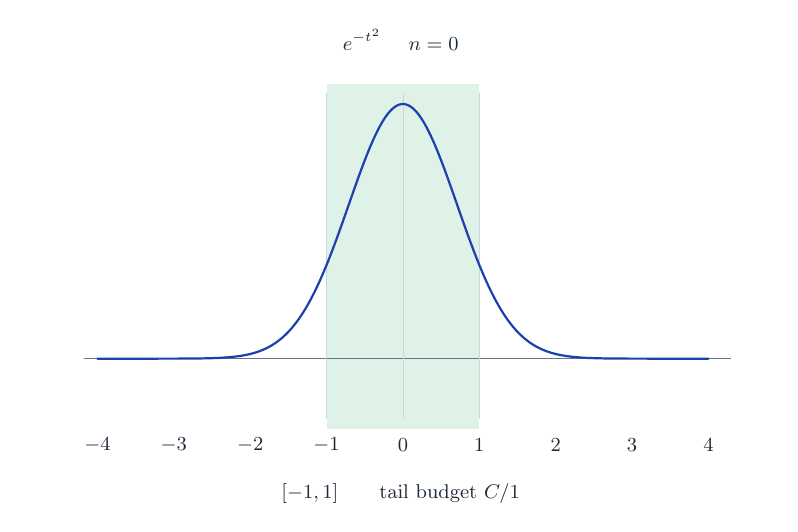

# The Gaussian integral from one-variable calculus

The Gaussian integral is a useful meeting point for several parts of the
foundation: geometric trigonometric functions, integration by parts, improper
integrals, and explicit convergence estimates. Its value can be proved without
multivariable calculus. The proof below uses the Wallis integrals, then
identifies their rescaled limit with the Gaussian integral.

Throughout, write

\[
G=\int_0^\infty e^{-x^2}\,dx.
\]

This improper integral is defined through its rational finite truncations and
a certified tail bound. The final full-line identity follows from evenness:

\[
\int_{-\infty}^{\infty}e^{-x^2}\,dx=2G=\sqrt{\pi}.
\]

## 1. Wallis integrals and their recurrence

For each natural number \(n\), set

\[
W_n=\int_0^{\pi/2}\cos^n(t)\,dt.
\]

Integration by parts, using the geometric sine and cosine, gives

\[
W_0=\frac{\pi}{2},\qquad W_1=1,\qquad
W_n=\frac{n-1}{n}W_{n-2}\quad(n\ge 2).
\]

Consequently, for every natural number \(k\),

\[
W_{2k}W_{2k+1}=\frac{\pi}{2(2k+1)}.
\]

The integrand decreases as its exponent increases on this interval, so
\(W_{2k+1}\le W_{2k}\le W_{2k-1}\). The recurrence also gives
\(W_{2k+1}=\frac{2k}{2k+1}W_{2k-1}\). Hence

\[
1\le \frac{W_{2k}}{W_{2k+1}}\le\frac{2k+1}{2k},
\]
and the ratio tends to one. Combining this with the product identity yields

\[
\lim_{n\to\infty}\sqrt{n}\,W_n=\sqrt{\frac{\pi}{2}}.
\]

These steps use only finite products, order, the one-variable integral, and
an explicit rational squeeze.

## 2. Rescaling the Wallis integrals

To keep every integration endpoint rational, use the normalized trigonometric
computation \(x\mapsto\cos(\pi x/2)\) on rational \(x\in[0,1]\). For each
positive integer \(m\), define

\[
A_m=\int_0^1\cos^{m^2}\!\left(\frac{\pi x}{2}\right)\,dx.
\]

The substitution \(t=\pi x/2\) gives \(W_{m^2}=\frac{\pi}{2}A_m\), so the
Wallis limit implies

\[
\lim_{m\to\infty}mA_m=\sqrt{\frac{2}{\pi}}.
\]

Now substitute \(u=mx\), again between rational endpoints, to obtain

\[
mA_m=\int_0^m
  \cos^{m^2}\!\left(\frac{\pi u}{2m}\right)\,du.
\]

For fixed \(u\), the integrand tends to \(e^{-\pi^2u^2/8}\). The
small-angle estimate needed here is

\[
\lim_{h\to0}\frac{\log(\cos h)}{h^2}=-\frac12,
\]
which can be derived from the geometric limit \(\sin h/h\to1\), the
identity \(1-\cos h=2\sin^2(h/2)\), and the corresponding logarithm
limit. A formal proof needs a quantitative version, obtained from explicit
geometric sine and cosine error bounds. Thus the rescaled Wallis integrals
approach the integral of this Gaussian.

## 3. Explicit tail control

The limit passage does not need a general dominated-convergence theorem. For
\(0\le h<\pi/2\), one has \(\tan h\ge h\): the derivative
of \(\tan h-h\) is \(\tan^2 h\ge0\), and its value at zero is zero.
Integrating the logarithmic derivative of cosine then gives

\[
\cos h\le e^{-h^2/2}.
\]

It follows that, whenever \(0\le u\le m\),

\[
0\le \cos^{m^2}\!\left(\frac{\pi u}{2m}\right)
\le e^{-\pi^2u^2/8}.
\]

For \(u\ge1\), the right side is at most \(e^{-\pi^2u/8}\). The latter has
an explicitly computable exponential tail. Given a rational cutoff \(R\),
the integral beyond \(R\) is thus bounded by a rationally chosen multiple of
\(e^{-\pi^2R/8}\), with the exponent evaluated using certified bounds for
\(\pi\) and \(\exp\). On each fixed rational compact interval, the
small-angle estimate supplies a quantitative convergence schedule. Together
these estimates justify the improper-integral limit using only finite
interval integrals and shrinking rational errors.

Therefore

\[
\int_0^\infty e^{-\pi^2u^2/8}\,du=\sqrt{\frac{2}{\pi}}.
\]

The positive change of scale \(x=\frac{\pi}{2\sqrt{2}}u\), or equivalently
the parameter scaling law for Gaussian integrals, then gives

\[
G=\int_0^\infty e^{-x^2}\,dx=\frac{\sqrt{\pi}}{2}.
\]

## 4. Where Feynman's parameter trick fits

For \(a>0\), define

\[
I(a)=\int_0^\infty e^{-a x^2}\,dx.
\]

Differentiation under the integral and integration by parts show

\[
I'(a)=-\int_0^\infty x^2e^{-a x^2}\,dx
      =-\frac{I(a)}{2a}.
\]

Thus \(I(a)=I(1)/\sqrt a\). This is the Feynman-parameter part of the
argument: it transports a known Gaussian value to every positive scale. It
does not determine \(I(1)\); the Wallis squeeze supplies that normalization.
Both pieces are worth retaining because the parameter calculation also
supports later Fourier and heat-kernel applications.

## Formalization status and interfaces

Lean computes the whole-line integral by fixed dyadic quadrature on
each rational window $[-R,R]$ and a separately certified tail.
`FourierQuadrature.gaussianDyadic_hasIntegralLimit` proves the
improper-integral role, and `gaussianDyadic_equiv_mass` compares it with
the independent bounded Taylor computations and their limit. The
identification with $\sqrt{\pi}$ is checked by a second one-variable route.
The Wallis construction above gives a separate proof route for the reader.

For the construction in the figure, stage \(n\ge 1\) uses the interval
\([-n,n]\) and mesh \(h=2^{-n}\). On every cell the endpoint farther from
zero gives the lower rectangle height, and the nearer endpoint gives the
upper height. The grid contains zero, so no cell crosses the maximum.
Beyond \(n\), \(x^2\ge x\). By symmetry the omitted mass satisfies

\[
0\le T_n=2\int_n^\infty e^{-x^2}\,dx
   \le 2\int_n^\infty e^{-x}\,dx=2e^{-n}.
\]

The lower rectangles give \(a\). For \(b\), add the two-tail allowance
to the upper rectangle sum. The displayed bounds also allow for the
rational enclosures used to evaluate the exponentials.

The Lean proof estimates the square of the finite-window Gaussian integral
using a one-variable comparison with the reciprocal kernel
\(1/(1+t^2)\). It bounds the discrepancy by explicit tails and uses the
already established identification of arctangent with geometric circle
area. This gives `FourierQuadrature.gaussianDyadic_square_equiv_pi`.
Positivity identifies the square root, giving
`FourierQuadrature.gaussianDyadic_equiv_sqrt_pi` for the actual dyadic
improper integral. The [Fourier chapter](07-fourier.md) uses this exact
normalization.

The axiom check for the named square-root comparison reports a computed
base case for the circle-area enclosure proved using `native_decide`.
The Fourier inversion theorem itself has a separate axiom check.
