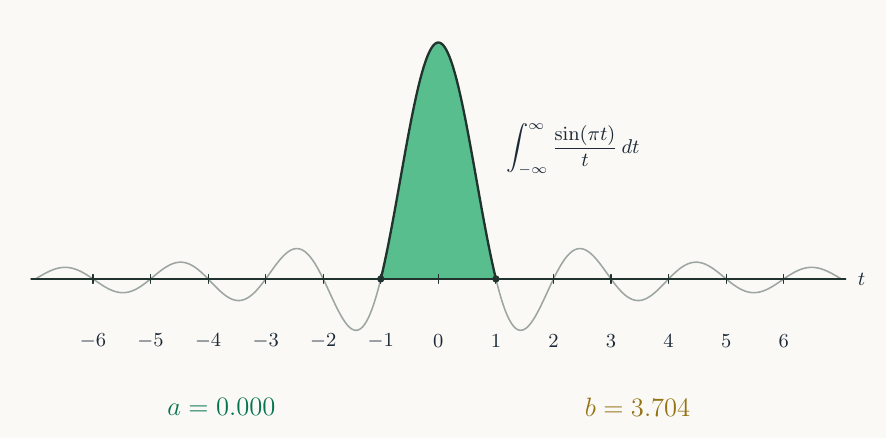

# Chapter 7. An improper integral and two evaluations

The Dirichlet integral connects geometric sine, Euler's exponential,
function-specific quadrature, and limits with certified errors:

$$
\int_0^\infty\frac{\sin x}{x}\,dx=\frac\pi2.
$$

**Checked status.** The independent improper computation, Feynman's parameter
argument, and the rectangular contour evaluation are Lean-checked in the
companion example `ComputableAnalysis.DirichletIntegral`.
`ContourEvaluation.integral_eq_pi_half` proves the contour result for the same
independently constructed improper integral. Its proof-dependency audit excludes
the parameter, damping, Laplace, and Feynman evaluation theorems.

The primary geometric sampler uses normalized angles. We begin with

$$
k(t)=\frac{\sin(\pi t)}t,\qquad t>0.
$$

The positive chart $x=\pi t$ preserves the displayed integral. Its actual
represented pullback, reciprocal, Jacobian, and coordinate round-trip are
checked in `DirichletIntegral.Radian`. Rational chart cutoffs have physical
endpoints $\pi\varepsilon$ and $\pi R$, which can be irrational.

## The independent improper computation

**Existing theorem, companion example.** `DirichletIntegral.compact_hasIntegral`
certifies actual finite rectangle quadrature on every rational segment
$[\varepsilon,R]$ with $0<\varepsilon\le R$. Geometric bounds and product FTC give

$$
|k(t)|\le8,\qquad
\left|\int_c^d k(t)\,dt\right|\le\frac2c\quad(0<c\le d).
$$

The second estimate captures cancellation by integration by parts. At the
origin, boundedness controls the missing segment without assigning a value
at the excluded endpoint. Absolute integrability at infinity is not assumed.

For $N=n+1$, compute the proper integral

$$
I_n=\int_{1/N}^{N}k(t)\,dt.
$$

Interval additivity and the endpoint estimates prove

$$
|I_m-I_n|\le\frac{10}{n+1}\qquad(n\le m).
$$

At each stage, choose a certified rational enclosure $B_n=[\ell_n,u_n]$ of
$I_n$ with a proved shrinking evaluation error. Enlarge it by the tail budget
and intersect the finite prefix:

$$
A_n=\bigcap_{j=0}^n
\left[\ell_j-\frac{10}{j+1},\ u_j+\frac{10}{j+1}\right].
$$

This is a finite rational algorithm. Each finite intersection covers later
compact integral values. Nonemptiness, nesting, and shrinking widths prove
that $n\mapsto A_n$ is a valid real name. Its first output is $[-10,10]$.
The definition contains no proposed closed-form answer.

**Existing theorems.** `DirichletIntegral.integral_hasIntegralLimit` certifies
the improper-integral role. `integral_truncation_error` gives the stronger
arbitrary-cutoff estimate

$$
\left|I-\int_\varepsilon^R k(t)\,dt\right|
\le8\varepsilon+\frac2R.
$$

Ordinary improper convergence is therefore established before either
calculation of the value. The reusable foundation modules are
`LipschitzQuadrature`, `EffectiveImproperIntegral`, and `TwoEndedQuadrature`.
Their inputs include actual proper integrals and proved quantitative errors;
their conclusions include validity and `HasIntegralLimit`.

Each finite window now uses the fixed grid in the normalized coordinate
$t=x/\pi$. The first and last cells are clipped to the endpoints. The
window error remains separate from the quadrature error.



## Feynman's real parameter

**Existing theorem, companion example.** Independently construct

$$
F(a)=\int_0^\infty E(-\pi at)\frac{\sin(\pi t)}t\,dt,
\qquad a\ge0,
$$

using its own proper quadratures and uniform oscillatory tails. Here $E$ is
the actual Euler-method solution of $E'=E$. For positive rational parameters,
differentiating removes the reciprocal factor:

$$
F'(a)=-\pi\int_0^\infty E(-\pi at)\sin(\pi t)\,dt
=-\frac1{1+a^2}.
$$

The justification uses finite estimates. Product FTC evaluates the
exponential-sine integral. The Euler parameter remainder retains its damping
factor, and an actual finite moment integral satisfies

$$
0\le\int_0^R tE(-\pi at)\,dt\le a^{-2}\qquad(a>0).
$$

After integration, this gives a cutoff-independent error:

$$
\left|F(v)-F(u)+\frac{v-u}{1+u^2}\right|
\le64\frac{(v-u)^2}{u^2}\qquad(0<u<v).
$$

`ParameterLimit.firstOrder_at` proves this for the constructed values.
`ParameterFTC.recover` applies FTC on positive compact parameter intervals:

$$
F(\delta)-F(M)=\int_\delta^M\frac{da}{1+a^2}.
$$

The parameter endpoint limits have explicit estimates. For rational $a\ge0$,
integer $N\ge1$, and rational $\ell>0$,

$$
|F(a)-I|\le\frac{20}{N}+64aN^2,
\qquad
|F(a)|\le8\ell+\frac{2}{\ell(1+a\ell)}.
$$

Choose $\delta=N^{-3}$, $M=N^3$, and $\ell=N^{-1}$. Then

$$
|F(\delta)-I|\le\frac{84}{N},\qquad |F(M)|\le\frac{10}{N}.
$$

The geometric arctangent and its reciprocal chart evaluate the parameter
integral with error at most $2/N$. The total error is $96/N$; shrinking it
proves exact equality of represented values.

The repository's `ShrinksToZero` predicate uses positive rational tolerances
and an $\varepsilon$–$N$ definition. The computations supply explicit samplers
and schedules that the convergence propositions verify. The checked argument
uses the displayed rational sequences and uniform estimates. It requires no
Mathlib real or complex numbers.

`Evaluation.independent_eq_feynman` proves agreement with the separate
geometric Feynman computation. `Evaluation.integral_eq_pi_half` and
`Radian.integral_eq_pi_half` prove the normalized and radian identities.

## A rectangular complex contour

**Existing theorem, companion example.** Move the pole
below the real axis. For $\eta>0$, take

$$
g_\eta(z)=\frac{e^{i\pi z}}{z+i\eta}
$$

around the counterclockwise rectangle

$$
0\longrightarrow R\longrightarrow R+iH\longrightarrow iH\longrightarrow0.
$$

The pole $-i\eta$ lies outside the rectangle, including its closed interior.
Take imaginary parts while the contour is finite. The left integral may grow as $\eta$ tends to zero, but its imaginary part is exactly zero at every stage. Its differential is

$$
g_\eta(iy)\,i\,dy=\frac{E(-\pi y)}{y+\eta}\,dy.
$$

Separate the imaginary bottom contribution into

$$
L_{\eta,R}=\int_0^R\frac{x\sin(\pi x)}{x^2+\eta^2}\,dx,
\qquad
C_{\eta,R}=\int_0^R\frac{\eta\cos(\pi x)}{x^2+\eta^2}\,dx.
$$

Rectangular Cauchy cancellation bounds $L_{\eta,R}-C_{\eta,R}$ by the
imaginary top and right contributions. There is no indentation at the origin.

Choose an integer $N\ge1$ and rational parameters

$$
\eta=N^{-2},\qquad R=N^3,\qquad H=N^2,\qquad d=N^{-1}.
$$

Use the coordinate maximum norm for complex error bounds. The circular
factor has coordinates bounded by one, and the Euler decay bound gives

$$
0\le E(-\pi y)\le\frac1{1+y}\qquad(y\ge0).
$$

For each fixed rectangle, use its literal midpoint boundary sums. Reciprocal
separation and the coordinate multiplication bound give

$$
|T_M|\le\frac{4R}{H^2},\qquad
|V_M|\le\frac{4H}{R},
$$

for every positive grid size $M$. Here $T_M$ and $V_M$ are the top and right
edge sums. Taking the width larger than the height makes both bounds shrink;
the right edge needs no subdivision into height ranges.

`ContourFunction.boundary_converges_zero` proves Cauchy cancellation for the
actual holomorphic function on the whole closed rectangle.
`LipschitzQuadrature.Data.midpoint_error` bounds the difference between the
bottom midpoint sum and the independently constructed proper integral.
The left sums have zero imaginary part exactly. These checked comparisons give

$$
|L_{\eta,R}-C_{\eta,R}|
\le\frac{4R}{H^2}+\frac{4H}{R}=\frac8N.
$$

To compare the sine term with the independently constructed $I$, split at
$x=\eta$. The lower segment contributes at most $8\eta$. On $[\eta,R]$,

$$
\left|\frac{\sin(\pi x)}x-
\frac{x\sin(\pi x)}{x^2+\eta^2}\right|
\le\frac{8\eta^2}{x^2}.
$$

The actual reciprocal-square integral bounds this difference by $8\eta$.
Combining these bounds with the original improper truncation estimate gives

$$
|L_{\eta,R}-I|\le24\eta+\frac2R.
$$

For the cosine term, first evaluate the rational Poisson kernel
$P_\eta(x)=\eta/(x^2+\eta^2)$. The geometric arctangent charts give, for
$R\ge\eta$,

$$
\int_0^R P_\eta(x)\,dx
=2\arctan(1)-\arctan(\eta/R),
\qquad
\left|\int_0^R P_\eta(x)\,dx-\frac\pi2\right|
\le\frac\eta R.
$$

The checked estimate uses the loose bound of three for this positive integral.
On $[0,d]$, the bound $|\cos(\pi x)-1|\le8d$ gives a weighted error at most $24d$.
On $[d,R]$, use $|\cos(\pi x)-1|\le2$ and
$P_\eta(x)\le\eta/x^2$, giving error at most $2\eta/d$. Hence

$$
\left|C_{\eta,R}-\frac\pi2\right|
\le24d+\frac{2\eta}{d}+\frac\eta R
=\frac{26}{N}+\frac1{N^5}.
$$

The three comparisons yield

$$
\left|I-\frac\pi2\right|
\le\frac{34}{N}+\frac{24}{N^2}+\frac2{N^3}+\frac1{N^5}
\le\frac{64}{N}.
$$

Shrinking this bound proves the exact identity. Each contour remains finite
while its boundary sums are compared; the rational parameters vary afterward.

**Existing theorems.** `ContourPoisson.integral_identity` and
`ContourPoisson.integral_error` evaluate the actual Poisson quadrature.
`ContourRegularization.sine_to_improper` compares the sine regularization with
the independently sampled improper integral. `ContourCosine.cosine_to_halfPi`
proves cosine concentration. `ContourLimit.regularized_relation` supplies the
proper-integral contour estimate, and `ContourEvaluation.error_bound` gives
the displayed shrinking error. `ContourEvaluation.integral_eq_pi_half` is the
exact final theorem.

The complex exponential in the contour is identified with the Euler real
exponential and the geometric rotation by common finite factorial prefixes.
The geometric Taylor theorem used for that comparison was independently derived
from repeated FTC. The contour argument's dependency audit finds only Lean's
standard logical axioms and no ambient Mathlib real or complex number type.

## Source and verification

The checked companion example is in
`subprojects/special-topics/ComputableAnalysis/DirichletIntegral/`.
The proof guide is `docs/DIRICHLET_INTEGRAL.md`. From the repository root:

```
cd subprojects/special-topics
lake build ComputableAnalysis.DirichletIntegral.ContourEvaluation
lake env lean ../../scripts/check_dirichlet_contour.lean
```

The checks cover exact theorem dependencies and ordinary executable definitions.
A finite midpoint computation supplements the mathematical proofs.
The standalone proof snapshot includes the required source modules, the pinned
Lean toolchain, and the verification records.

## Reproduce the rectangular proof

Download the [self-contained Lean sources](dirichlet-contour-proof.tar.gz) and the [verification report](dirichlet-contour-verification.json). The archive includes the exact import closure and the pinned Lean toolchain; no Mathlib dependency is required.
