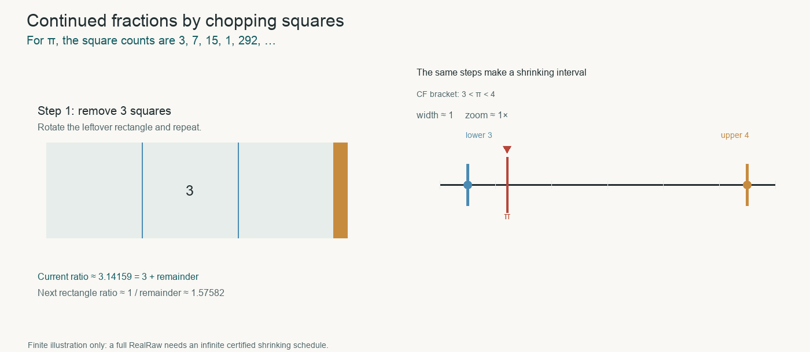
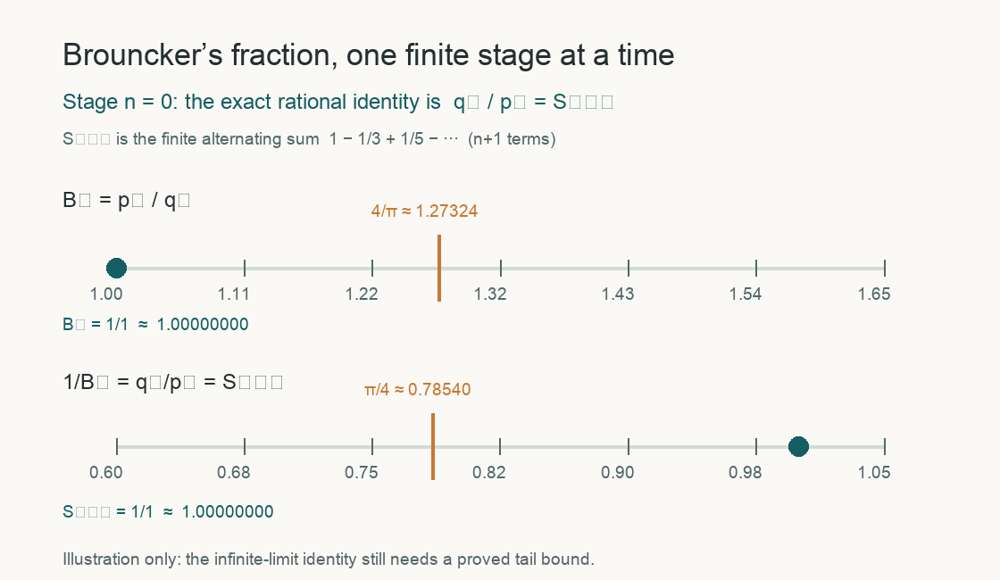

# Chapter 8. Continued fractions and pi

## Finite fractions are rational computations

A continued fraction becomes a computation when we specify its finite
approximants. For a generalized continued fraction

$$
b_0+\cfrac{a_1}{b_1+\cfrac{a_2}{b_2+\cfrac{a_3}{b_3+\cdots}}},
$$

the convergents are rational numbers computed from finite data. One useful
recurrence is

$$
p_{-1}=1,\quad p_0=b_0,\quad q_{-1}=0,\quad q_0=1,
$$

$$
p_n=b_n p_{n-1}+a_n p_{n-2},\qquad
q_n=b_n q_{n-1}+a_n q_{n-2}.
$$

The stage-$n$ approximation is $p_n/q_n$, when $q_n\ne0$. Thus every stage
uses rational arithmetic only. The recurrence also exposes the exact
determinant identity

$$
p_nq_{n-1}-p_{n-1}q_n=(-1)^{n-1}a_1a_2\cdots a_n.
$$

This identity explains the alternating order of adjacent convergents when
the partial numerators are positive. It does not, by itself, prove that their
gap tends to zero. A represented value needs rational lower and upper bounds
whose gap has an explicit schedule tending to zero. We may use consecutive
convergents when they bracket the value and their gap has a proved shrinking
bound; otherwise we use certified tail bounds or finite prefix intersections.

This chapter treats a continued fraction as another error-certified
computation of a number. A formal proof must establish the actual finite
recurrence, bound its tails, and prove validity of the resulting `RealCompute`.
The infinite notation is a summary of those finite proofs, not a separate
definition that assumes convergence.

## Reading a `RealCompute` as digits or as a continued fraction

A `RealCompute` already has the right first interface: at stage $n$ it returns a
rational interval, and validity says the intervals are nested and shrink.
`RealCompute.decimalAt` prints finite-decimal renderings of the two rational
endpoints to a requested number of places, alongside the interval width. The
exact rational interval is the certificate; its rounded display strings are
for reading and need not themselves be outward bounds. If the desired output
is one rounded decimal value, an interval straddling a rounding boundary must
be refined or the boundary decision must be supplied separately.

A continued-fraction prefix is a different kind of output. For a positive
value $x$, its first coefficient is $a_0=\lfloor x\rfloor$; after that we
replace $x$ by $1/(x-a_0)$ and repeat. Each step uses rational interval
arithmetic: refine until the interval certifies a unique integer part, then
certify that the remainder is separated from zero before taking its
reciprocal. The next coefficient is obtained the same way. Thus Lean can
compute and prove each finite prefix using only integer and rational
operations, together with the interval validity and separation proofs.

There is a real boundary issue here. If a remainder is exactly zero, the
continued fraction terminates; if it is merely very small, more precision is
needed. A shrinking interval eventually decides the integer part when the
value is not an integer, but shrinking alone cannot certify equality with an
integer. Therefore a uniform function that always returns either “the next
coefficient” or “the expansion has ended” needs additional equality evidence
at rational termination points. A practical interface can instead return a
certified finite prefix when its separation conditions are met, and return
the proof data explaining why each requested coefficient is determined.
For a number known to be irrational, each finite prefix exists; to make that
an executable total API, the proof must also provide a terminating
refinement search for every finite stage.

For the circle-area value of pi, the continued fraction

$$
\pi=[3;7,15,1,292,1,1,1,2,1,\ldots]
$$

is a useful regular-fraction output. For example, its first convergents are
$3$, $22/7$, $333/106$, and $355/113$. A formal computation of any particular
finite prefix can be certified by refining the existing rational interval
algorithm for pi until every floor decision is forced. An infinite expansion
requires the stronger general argument that every later remainder is
nonzero; this is where irrationality, or another suitable separation theorem,
enters. The chapter's generalized fractions below give another route: define
their rational convergents directly and prove a tail bound, without first
extracting coefficients from an arbitrary real.

The geometric picture starts with a rectangle whose side ratio is $\pi$.
Remove $3$ unit squares from its long side; turn the leftover strip and
rescale it to make the next rectangle. The next square counts are $7$, $15$,
$1$, and $292$, continuing the continued-fraction expansion. In general,
each count is the next integer part, and the leftover rectangle carries the
remainder into the next step.

The animation pairs these square chop-offs on the left with rational
continued-fraction bounds for $\pi$ on the right. The interval zoom follows
the same stages smoothly. This finite illustration shows the shape of a
`RealCompute` computation; a real definition still needs an infinite certified
shrinking schedule.

## Two classical fractions for the same pi

The classical Brouncker fraction is

$$
\frac{4}{\pi}=
1+\cfrac{1^2}{2+\cfrac{3^2}{2+\cfrac{5^2}{2+\cfrac{7^2}{2+\cdots}}}}.
$$

Euler's fraction gives a second presentation:

$$
\pi=
3+\cfrac{1^2}{6+\cfrac{3^2}{6+\cfrac{5^2}{6+\cfrac{7^2}{6+\cdots}}}}.
$$

Let $B$ denote the value of the right-hand side of Brouncker's fraction and
$E$ the value of the right-hand side of Euler's fraction. Brouncker's
fraction computes $4/\pi$, while Euler's computes $\pi$. They are not
term-by-term identical fractions, and their finite convergents follow
different paths. The exact comparisons we aim to prove with the geometric
constant `piCircleArea` from Chapter 2 are:

$$
 B\simeq\frac{4}{\pi_{\rm circle}},
 \qquad E\simeq\pi_{\rm circle}.
$$

Since the fraction $B$ is positive, its reciprocal is defined, and these
identities give the useful equivalences

$$
\frac{4}{B}\simeq E\simeq\pi_{\rm circle},
\qquad BE\simeq4.
$$

This comparison is stronger than observing that their decimal
approximations agree. A direct transformation between their finite
convergents is an exact rational identity, but it still needs a shrinking
error argument before it identifies the infinite values.

## The common bridge through arctangent

The natural shared value is the geometric arctangent at one:

$$
\pi_{\rm circle}=4\,\arctan(1)
=4\int_0^1\frac{dt}{1+t^2}.
$$

The integral and circle-area identity belong to Chapter 2. For Euler's
fraction, compare its finite rational convergents with rational bounds for
this same pi value (or with finite alternating arctangent sums whose
remainder is already certified). For Brouncker's fraction, compare with the
reciprocal value $1/\arctan(1)$, keeping a proved positive lower bound so
reciprocation is valid. Each comparison must account for the full finite
error on both sides. Merely recognizing a familiar continued-fraction
pattern or matching finitely many coefficients does not establish the value.

The checked finite Brouncker transformation is particularly direct. If
$B_n=p_n/q_n$ is the $n$-th Brouncker convergent and
$S_{n+1}=\sum_{k=0}^{n}(-1)^k/(2k+1)$, then rational algebra proves

$$
\frac{q_n}{p_n}=S_{n+1}.
$$

Thus every finite reciprocal convergent is exactly a finite Leibniz sum.
The animation shows these paired finite computations at successive stages;
it is a visual guide, while the proof still needs the reciprocal tail estimate
described next.

The remaining infinite step is now sharply isolated: use the certified
alternating-series error for $S_{n+1}$, a positive lower bound, and a
reciprocal error estimate to build nested shrinking bounds for $B$. Then
identify the limit of $S_{n+1}$ with geometric $\arctan(1)$ and use
$\pi_{\rm circle}=4\arctan(1)$. This proves the Brouncker identity without
appealing to a decimal match. The Euler fraction has its own finite
transformation and tail estimate; those are not consequences of the
Brouncker identity alone. No appeal to complex analysis, Lebesgue
integration, or abstract completion is needed for the intended construction.

## What an implementation should expose

The reusable Lean interface should separate these pieces:

- a rational finite-convergent recurrence for arbitrary supplied partial
  numerators and denominators, with determinant and adjacent-convergent
  identities proved by finite algebra;
- a certificate giving valid lower and upper bounds, plus a shrinking width
  schedule, for a particular continued fraction;
- a `RealCompute` value constructed from those certified intervals;
- exact comparison theorems identifying each pi continued fraction with
  `piCircleArea` and with one another.

The finite-prefix conversion from a valid real interval computation is a
separate interface. It should make the required nonzero-remainder or exact
termination evidence explicit. Do not make ordinary `RealCompute` validity
silently imply that all continued-fraction choices are decidable.

The generic recurrence is useful independently, but it is not a universal
convergence theorem. Positivity of the coefficients can give order
information; a separate quantitative argument must still prove shrinking.
The pi examples should carry their own bounds and proof of mathematical
identity, just as the foundation lets other elementary constants have
multiple proved-equal computation methods.

## Proposition target

**Open target CF-01.** Construct the specific `CertifiedConvergents`
certificates for the right side $B$ of Brouncker's fraction and the right
side $E$ of Euler's fraction. Prove $B$ valid and equal to
$4/\pi_{\rm circle}$, prove $E$ valid and equal to $\pi_{\rm circle}$,
establish positivity of $B$, and derive $4/B\simeq E$. Keep the finite
convergents rational and supply explicit shrinking tail enclosures. A later
optimization may compare or accelerate the two evaluators, but is not needed
for the identity theorem.

**Open target CF-02 (best approximation of the second kind).** Let $x$ be an
irrational value in our `ComputableAnalysis.Real`, with regular continued-fraction
convergents $p_n/q_n$ and $p_{n+1}/q_{n+1}$. For every integer $p$ and every
positive integer $q<q_{n+1}$, prove

$$
|qx-p|\;\ge\;|q_nx-p_n|.
$$

This is the precise “best approximation” statement intended here: it
minimizes $|qx-p|$ among denominators below the next convergent's denominator.
It is often called best approximation of the second kind; it does not assert
that $p_n/q_n$ minimizes $|x-p/q|$ under that same cutoff. State the public
theorem on quotient values and derive a raw-name corollary invariant under
`RealCompute.Equiv`. The proof should expose the finite recurrence, determinant
identity, and order evidence that locate $x$ between adjacent convergents.
Irrationality ensures the regular continued fraction does not terminate; it
does not replace the quantitative error comparison in the theorem. This
target is independent of the Brouncker/Euler tail certificates in CF-01.

**Checked Lean groundwork.** `ComputableAnalysis.ContinuedFraction` defines
the finite rational recurrence, proves the adjacent-convergent determinant
identity, and computes initial convergents for the Brouncker and Euler
fractions. It also proves `brouncker_finite_leibniz` and
`brouncker_reciprocal_convergent_eq_leibniz`: at each finite stage, the
reciprocal of the Brouncker convergent is exactly the matching alternating
arctangent partial sum. `CertifiedConvergents.raw_valid` constructs a valid
`RealCompute` from explicit nested shrinking tail enclosures, and
`raw_equiv_of_same_convergents` proves exact equality for any two certified
error schedules of the same convergent sequence. The reciprocal-limit
certificate for Brouncker and the finite transformation and tail certificate
for Euler remain open, as do the final pi identities in CF-01.
`ComputableAnalysis.Pi` defines the circle-area pi, the Leibniz and
Nilakantha series, and Machin's formula.

## Sources for the classical formulas

- [Mathematical Association of America, history of continued fractions](https://old.maa.org/press/periodicals/convergence/connecting-greek-ladders-and-continued-fractions-history-of-continued-fractions) gives Brouncker's formula and its historical connection with Wallis.
- [MacTutor, William Brouncker](https://mathshistory.st-andrews.ac.uk/Biographies/Brouncker/) records the same expansion and its historical context.
- [Wolfram MathWorld, Pi Continued Fraction](https://mathworld.wolfram.com/PiContinuedFraction.html) lists Euler's generalized fraction for pi.
